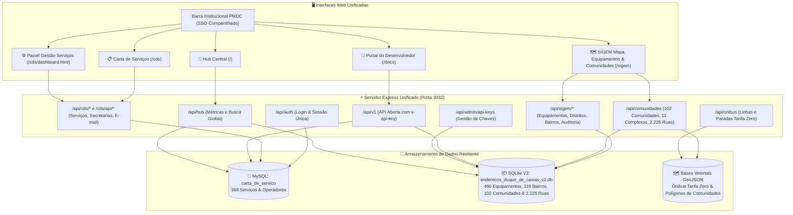

# 🏛️ PREFEITURA MUNICIPAL DE DUQUE DE CAXIAS — RJ
## Portal Unificado de Serviços Municipais, Geoprocessamento, Mobilidade & Território
### 📋 Carta de Serviços ao Cidadão + 🗺️ SIGEM + 🚌 Ônibus Tarifa Zero + 🏘️ Comunidades & Favelas (SIMAC) + 🧠 Análise Territorial Inteligente
**Versão:** 2.3  
**Data:** 20/10/2026  

Bem-vindo ao repositório do **Portal Unificado da Prefeitura de Duque de Caxias**, a consolidação oficial e otimizada dos pilares estruturantes da administração pública municipal:

1. **📋 Carta de Serviços ao Cidadão:** O guia e painel oficial com **368 serviços públicos homologados** (100% livres de duplicidades) das 18 secretarias municipais (etapas, documentação exigida, prazos de atendimento, taxas e fundamentação legal).
2. **🗺️ SIGEM (Endereços & Equipamentos):** Plataforma GIS e cadastro técnico de todos os **466 equipamentos e prédios públicos** (escolas, postos de saúde, secretarias, CRAS, praças e polos prediais) distribuídos pelos 4 distritos e 118 bairros oficiais.
3. **🧠 Análise Territorial Inteligente (Módulo Avançado):** Diagnóstico geoespacial em tempo real com **buffers de cobertura (300m a 2.000m)**, identificação de **sobreposições de atendimento**, diagnóstico contra as **102 comunidades** e **simulador interativo de novos equipamentos** com impacto social imediato.
4. **🚌 Mobilidade Urbana (Ônibus Tarifa Zero):** Módulo de transporte público municipal gratuito com as **16 linhas municipais** e paradas georreferenciadas com itinerários e arquivos abertos em GeoJSON.
5. **🏘️ Diagnóstico Socioterritorial (Comunidades, Favelas & Complexos — Ações Comunitárias / SIMAC v2.0):** Base oficial consolidada com **102 comunidades e favelas** (63 oficiais dos 10 Grandes Complexos + 39 setores periféricos), **11 complexos territoriais** com paleta oficial de cores, **2.225 ruas internas e becos**, **225 faixas de CEP** e o **contorno municipal oficial** integrados ao mapa interativo e buscas.
6. **📖 API Pública e Portal do Desenvolvedor:** APIs REST v1 para parceiros com autenticação por chave de API (`x-api-key`), limitação de taxa e documentação interativa em `/docs`.

---

## 🏗️ Arquitetura Unificada

O projeto foi construído em **Node.js (v22+) com TypeScript**, unificando servidores, portas, bancos de dados e interfaces em uma arquitetura limpa, escalável e de alto desempenho:



---

## 🚀 Como Executar o Projeto

### 1. Iniciar em Modo de Desenvolvimento (Hot-Reload com TSX):
```bash
npm run dev
```

### 2. Acessar no Navegador:
- **Painel Central (Hub Integrado):** 👉 [http://localhost:3032/](http://localhost:3032/)
- **Carta de Serviços (Cidadão):** 👉 [http://localhost:3032/cds](http://localhost:3032/cds)
- **Painel Administrativo de Serviços:** 👉 [http://localhost:3032/cds/dashboard.html](http://localhost:3032/cds/dashboard.html)
- **SIGEM (Mapa Interativo & Equipamentos):** 👉 [http://localhost:3032/sigem](http://localhost:3032/sigem)
- **Portal do Desenvolvedor & Documentação Interativa:** 👉 [http://localhost:3032/docs](http://localhost:3032/docs)
- **Estatísticas e KPIs Globais (JSON):** 👉 [http://localhost:3032/api/hub/stats](http://localhost:3032/api/hub/stats)
- **Diagnóstico de Comunidades & Favelas (JSON):** 👉 [http://localhost:3032/api/comunidades/resumo](http://localhost:3032/api/comunidades/resumo)
- **Camada GeoJSON de Comunidades:** 👉 [http://localhost:3032/api/comunidades/geojson](http://localhost:3032/api/comunidades/geojson)
- **Resumo Ônibus Tarifa Zero (JSON):** 👉 [http://localhost:3032/api/onibus/resumo](http://localhost:3032/api/onibus/resumo)

### 3. Credenciais Padrão de Administrador:
- **Usuário:** `admin`
- **Senha:** `admin123`

---

## 🗂️ Estrutura de Diretórios

```text
unificados/
├── dados/                         # Repositório de dados oficiais
│   ├── enderecos_duque_de_caxias_v2.db # Banco SQLite oficial (466 equipamentos, 102 comunidades, 2.225 ruas)
│   ├── comunidades_master.json    # Base mestre consolidada com polígonos, ruas e CEPs
│   ├── geojson_comunidades/       # GeoJSONs individuais dos 10 complexos e setores
│   ├── schema_e_dados_v2.sql      # Dump DDL+DML para restauração a frio
│   ├── todos_os_enderecos_duque_de_caxias.json # Base mestre de equipamentos gerada
│   └── por_setor/                 # 6 Bases setoriais homologadas (Excel-ready)
│
├── cadernos/                      # 29 Cadernos temáticos por secretaria
├── cartas_de_servico/             # 25 Cadernos oficiais de serviços em Markdown
├── docs/                          # Documentação técnica oficial de engenharia
│   ├── auditoria_tecnica.md       # Auditoria técnica e baseline
│   ├── arquitetura_atual.md       # Arquitetura física e lógica atual
│   ├── arquitetura_alvo.md        # Arquitetura alvo recomendada
│   ├── catalogo_apis.md           # Catálogo completo e contrato de APIs
│   ├── modelo_dados.md            # Especificação de bancos e modelo relacional
│   ├── matriz_permissoes.md       # Matriz RBAC e regras de acesso
│   ├── plano_testes_homologacao.md# Roteiro de testes e critérios de aceite
│   ├── plano_backup_rollback.md   # Rotinas de contingência e backup
│   └── limpeza_repositorio.md     # Inventário e governança do repositório
│
├── public/                        # Interfaces Web (Frontends)
│   ├── hub/                       # 🌟 Portal Central Integrador (Busca global e métricas)
│   ├── cds/                       # 📋 Carta de Serviços (Portal do Cidadão e Dashboard)
│   ├── sigem/                     # 🗺️ SIGEM (Painel GIS, Mapa Leaflet e Gerenciador)
│   │   └── dados/geojson/         # Camadas Ônibus Tarifa Zero e Comunidades (102 polígonos)
│   ├── api/                       # 📖 Portal do Desenvolvedor e Console OpenAPI (/docs)
│   └── shared/                    # 🏛️ Componentes Compartilhados (Barra PMDC e SSO)
│
├── src/                           # ⚡ Backend em TypeScript (Strict Mode)
│   ├── config/index.ts            # Configurações de ambiente, portas e caminhos
│   ├── database/
│   │   ├── mysql.ts               # Pool de conexões MySQL (carta_de_servico)
│   │   └── sqlite.ts              # Conexão de alta performance com SQLite nativo (WAL Mode)
│   ├── middlewares/
│   │   ├── auth.ts                # Autenticação JWT unificada (Admin + Secretarias)
│   │   ├── apiKeyAuth.ts          # Autenticação e Rate-Limiting por API Key (v1)
│   │   └── audit.ts               # Trilha de auditoria no SQLite do SIGEM
│   ├── routes/
│   │   ├── auth.ts                # Login unificado (/api/auth)
│   │   ├── hub.ts                 # Métricas e busca cruzada (/api/hub)
│   │   ├── cdsServices.ts         # CRUD de serviços municipais (/api/cds/services)
│   │   ├── cdsAdmin.ts            # Gestão de secretarias e operadores (/api/cds/admin)
│   │   ├── cdsProfile.ts          # Alteração de perfil do operador (/api/cds/profile)
│   │   ├── cdsEmail.ts            # Disparo de e-mails com anexo XLSX (/api/cds/email)
│   │   ├── sigem.ts               # CRUD de equipamentos, bairros, distritos e auditoria (/api/sigem)
│   │   ├── comunidades.ts         # Comunidades, complexos, ruas e polígonos (/api/comunidades)
│   │   ├── onibus.ts              # Linhas e paradas do Ônibus Tarifa Zero (/api/onibus)
│   │   ├── externalApi.ts         # API pública/externa v1 para terceiros (/api/v1)
│   │   └── adminApiKeys.ts        # Gestão administrativa de chaves de API (/api/admin/api-keys)
│   ├── services/
│   │   ├── geocodingService.ts    # Validação espacial e geocodificação Nominatim
│   │   ├── mailer.ts              # Transporter Nodemailer
│   │   ├── xlsxGenerator.ts       # Gerador Excel com ExcelJS
│   │   └── sigemExporter.ts       # Motor de exportação com circuit-breaker
│   ├── templates/
│   │   └── emailTemplate.ts       # Layouts responsivos de e-mail institucional
│   ├── types/
│   │   └── index.ts               # Contratos e tipos compartilhados em TypeScript
│   └── index.ts                   # Servidor Express central com Global Error Handler
│
├── scripts/                       # Ferramentas operacionais e testes automatizados
├── setup_tables.sql               # Script DDL de tabelas do MySQL
├── CARTA_DE_SERVICO_AJUSTE_23.05.26.xlsx # Planilha mestre consolidada da Carta
├── ecosystem.config.js            # Configuração de cluster e daemon PM2
├── nginx_unificados.conf          # Configuração de reverse proxy para produção
├── .env.example                   # Modelo seguro de variáveis de ambiente
├── .env                           # Credenciais locais (ignorado no git)
├── .gitignore                     # Governança estrita de repositório
├── package.json                   # Dependências e scripts de ciclo de vida
└── tsconfig.json                  # Compilador TypeScript com Strict Mode ativado
```

---

## 🛡️ Destaques de Governança & Segurança

- **Auditoria Transacional:** Todas as alterações cadastrais em equipamentos (criação, edição e exclusão) são gravadas com timestamp, usuário e diff JSON no banco relacional.
- **Content Security Policy (CSP):** Configuração segura via Helmet liberando fontes do Google, Typekit, Leaflet Tiles (OpenStreetMap) e ícones sem gerar erros de console.
- **Single Sign-On (SSO):** O operador autentica-se uma única vez e navega entre a gestão de cartas de serviços e a gestão de equipamentos com a mesma sessão ativa.
- **Resiliência Multi-Database:** Falhas transitórias no MySQL não derrubam as consultas geoespaciais no SQLite, e vice-versa.
- **API Keys & Rate Limiting:** Emissão de chaves seguras permanente com quotas automáticas de requisições por minuto e por dia.

---

## 🎯 Módulo Inteligente de Análise Territorial & Simulação (SIGEM)

Integrado diretamente ao mapa oficial de Duque de Caxias via menu suspenso flutuante (**Análise Territorial Inteligente**), transformando o SIGEM em uma ferramenta preditiva de apoio a decisões estratégicas de infraestrutura pública:

1. **Análise de Cobertura & Buffers Métricos:**
   - Motores geoespaciais com **Turf.js** calculando zonas de influência métricas (300m, 500m, 1 km, 2 km e 3 km).
   - Suporte a filtros temáticos: Escolas e Creches (209 un.), Unidades de Saúde (95 un.), Paradas de Ônibus Tarifa Zero (1.795 paradas), FUNDEC (35 un.), Assistência Social (47 un.) e Base Consolidada (466 un.).
2. **Diagnóstico de Comunidades & Favelas Desassistidas:**
   - Cruzamento geográfico automático contra os polígonos das **105 comunidades e favelas** do município.
   - Classificação instantânea de comunidades cobertas vs. comunidades desassistidas em situação de déficit de atendimento.
   - Lista interativa com navegação rápida (`flyTo`) para inspeção de gargalos socioterritoriais.
3. **Simulador Interativo de Novos Equipamentos (Cenários Hipotéticos):**
   - Inserção de novos equipamentos hipotéticos com clique direto no mapa.
   - Marcador dourado arrastável (`drag-and-drop`) com recalculo de cobertura e ganho populacional em tempo real.
4. **Relatórios & Exportação:**
   - Download imediato de relatórios técnicos em JSON estruturado com métricas, parâmetros e lista de comunidades prioritárias.

