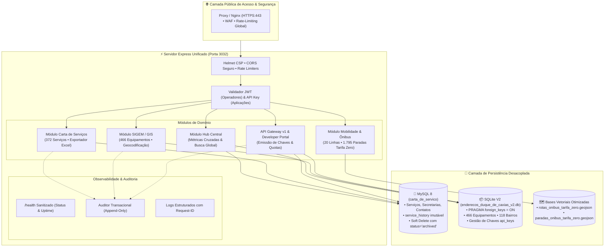

# 🎯 Arquitetura-Alvo Recomendada
## Portal Unificado PMDC — Carta de Serviços ao Cidadão + SIGEM
**Prefeitura Municipal de Duque de Caxias — RJ**  
**Versão:** 2.1 (Atualizada com API Gateway, Mobilidade Tarifa Zero e Camadas Geoespaciais)  
**Data:** 20/10/2026  

---

## 1. Princípios Arquiteturais e Metas

A arquitetura-alvo consolida a resiliência, a segurança e a governança de dados do Portal Unificado a partir dos seguintes princípios:

1. **Desacoplamento e Resiliência Parcial:** Falhas temporárias no MySQL não devem paralisar as consultas cartográficas do SIGEM ou as linhas de ônibus; da mesma forma, falhas no SQLite não devem interromper a prestação de serviços no CDS.
2. **Autorização Centralizada e Imutável no Servidor:** O frontend é uma camada de conveniência visual. Toda validação de permissão (JWT para servidores e API Key para sistemas externos) ocorre estritamente no backend.
3. **Auditoria Transacional Estrita com Preservação de Histórico:** Proibição de exclusões físicas em cascata que destruam logs. Adoção integral de arquivamento lógico (`soft-delete`).
4. **Proteção de Informações Internas (Zero Information Disclosure):** Endpoints de saúde e respostas de erro devem ser sanitizados para nunca expor caminhos locais, credenciais ou stack traces.
5. **Abertura de Dados e Integração Metropolitana (Open Data & GIS):** Disponibilização de contratos públicos para desenvolvedores com controle rigoroso de quotas e telemetria de chamadas.

---

## 2. Diagrama da Arquitetura-Alvo



---

## 3. Gestão da Arquitetura Dual-Engine & Resiliência

### 3.1 Falhas Parciais e Resiliência do Hub
Como os dois bancos não compartilham transação distribuída, o endpoint `/api/hub/stats` trata falhas individualmente:
- Se o MySQL falhar, as informações do SIGEM e do Ônibus Tarifa Zero continuam respondendo normalmente.
- Se o SQLite falhar, o catálogo da Carta de Serviços permanece ativo para consulta e edição.

### 3.2 Política de Exclusão: Fim do `CASCADE` Destrutivo
- **MySQL (`services`):** Substituição de exclusões físicas por `status = 'archived'`. O registro é ocultado do portal do cidadão, mas a trilha em `service_history` e o cadastro original são preservados para órgãos de controle.
- **SQLite (`equipamentos`):** Atualização para `status = 'INATIVO'` ou `'ARQUIVADO'` ao invés de deleção física.

---

## 4. Estrutura Canônica do Repositório

```text
unificados/
├── dados/                         # Bases de dados oficiais e backups
│   ├── enderecos_duque_de_caxias_v2.db
│   └── backups/
├── docs/                          # Documentação técnica oficial de engenharia
│   ├── auditoria_tecnica.md
│   ├── arquitetura_atual.md
│   ├── arquitetura_alvo.md
│   ├── modelo_dados.md
│   ├── catalogo_apis.md
│   ├── matriz_permissoes.md
│   ├── plano_testes_homologacao.md
│   ├── plano_backup_rollback.md
│   └── limpeza_repositorio.md
├── public/                        # Frontends estáticos
│   ├── hub/
│   ├── cds/
│   ├── sigem/
│   │   └── dados/geojson/         # Camadas espaciais de ônibus
│   ├── api/                       # Portal do Desenvolvedor (/docs)
│   ├── shared/
│   └── login.html
├── src/                           # Código-fonte TypeScript
│   ├── config/
│   ├── database/
│   ├── middlewares/
│   ├── routes/
│   ├── services/
│   └── index.ts
├── scripts/                       # Ferramentas operacionais e validação
├── package.json
└── tsconfig.json
```
