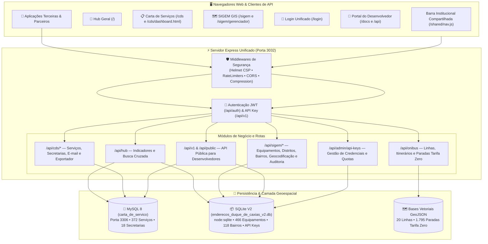

# 🏗️ Arquitetura Atual do Sistema
## Portal Unificado PMDC — Carta de Serviços ao Cidadão + SIGEM
**Prefeitura Municipal de Duque de Caxias — RJ**  
**Versão Documentada:** 2.1 (Atualizada com Ônibus Tarifa Zero, API Externa v1 e Gestão de Chaves)  
**Data:** 20/10/2026  

---

## 1. Visão Geral da Arquitetura

O sistema opera sob uma arquitetura monolítica modular de alta performance construída em **Node.js com TypeScript** sobre o framework **Express**, adotando o modelo **Dual-Engine Relacional** (MySQL + SQLite) somado a uma camada geoespacial otimizada em GeoJSON.



---

## 2. Componentes de Software & Stack Técnica

### 2.1 Runtime & Compilação
- **Runtime:** Node.js v22.21.0 nativo.
- **Linguagem:** TypeScript 5.7.3 em Strict Mode.
- **Execução em Desenvolvimento:** `tsx watch src/index.ts` (execução direta em memória com TypeScript sem build prévio e com hot reload).
- **Execução em Produção:** `node dist/index.js` (gerado pelo compilador oficial `tsc` com hook `"prestart": "tsc"`).

### 2.2 Camada de Servidor (Express)
- **Porta Padrão:** `3032` (configurável via `PORT` no `.env`, com suporte a modo SIGEM dedicado via `APP_MODE=sigem` ou porta `3015`).
- **Tratamento de Favicons:** Handlers específicos para `/favicon.ico`, `/cds/favicon.ico` e `/sigem/favicon.ico` retornando `204 No Content`.
- **Encerramento Gracioso (Graceful Shutdown):** Captura de sinais `SIGINT` e `SIGTERM` fechando conexões do pool MySQL e do banco SQLite com liberação segura de locks de arquivo.

### 2.3 Camada de Segurança e Middlewares
1. **Helmet & Content Security Policy (CSP):**
   - Configuração estrita liberando fontes do Google e Typekit, CDNs (cdnjs, unpkg, jsdelivr), tiles do OpenStreetMap para o mapa Leaflet e conexões com ViaCEP e ArcGIS.
2. **Rate Limiting:**
   - Limiter geral da API: 500 requisições a cada 15 minutos por IP.
   - Limiter de autenticação (`/api/auth/login`): 30 tentativas a cada 15 minutos por IP.
   - Quotas por API Key: 60 ou 120 requisições por minuto e 10.000 a 50.000 requisições diárias.
3. **Autenticação & SSO:**
   - Baseado em tokens JWT para operadores e administradores.
   - Chaves de API no padrão `pmdc_live_<hex>` para desenvolvedores e integração de terceiros.
   - Sessão única sincronizada entre os módulos através do `localStorage` gerenciado por [public/shared/nav.js](file:///c:/Users/501379.PMDC/Desktop/unificados/public/shared/nav.js).

---

## 3. Estrutura de Diretórios e Módulos

```text
unificados/
├── dados/                         # Repositório de dados SQLite, dumps e bases setoriais
│   ├── enderecos_duque_de_caxias_v2.db # Banco SQLite oficial (466 equipamentos)
│   ├── schema_e_dados_v2.sql      # Dump DDL+DML para restauração a frio
│   ├── todos_os_enderecos_duque_de_caxias.json # Base mestre gerada
│   └── por_setor/                 # 6 Bases setoriais homologadas
├── docs/                          # Documentação técnica oficial de engenharia
│   ├── auditoria_tecnica.md       # Relatório de conformidade e auditoria
│   ├── arquitetura_atual.md       # Arquitetura física e lógica vigente
│   ├── arquitetura_alvo.md        # Roadmap e melhorias planejadas
│   ├── catalogo_apis.md           # Contrato completo de rotas e APIs
│   ├── modelo_dados.md            # Diagramas ER e dicionário de tabelas
│   ├── matriz_permissoes.md       # Matriz RBAC e regras de isolamento
│   ├── plano_testes_homologacao.md# Roteiro de homologação e critérios de aceite
│   ├── plano_backup_rollback.md   # Rotinas de contingência e restauração
│   └── limpeza_repositorio.md     # Inventário e governança do código
├── public/                        # Interfaces Web estáticas (Frontend)
│   ├── hub/                       # Portal Integrado Central (/)
│   ├── cds/                       # Carta de Serviços ao Cidadão e Dashboard (/cds)
│   ├── sigem/                     # Geoprocessamento, Mapa GIS e Gerenciador (/sigem)
│   │   └── dados/geojson/         # Camadas vetoriais de Ônibus Tarifa Zero
│   ├── api/                       # Portal do Desenvolvedor e documentação interativa (/docs, /api)
│   ├── shared/                    # Barra Institucional PMDC e SSO (/shared)
│   └── login.html                 # Página única de autenticação institucional (/login)
├── src/                           # Código-fonte TypeScript
│   ├── config/index.ts            # Carregamento centralizado de variáveis de ambiente
│   ├── database/
│   │   ├── mysql.ts               # Pool de conexões MySQL2 com Promise
│   │   └── sqlite.ts              # Conexão síncrona nativa com node:sqlite (WAL Mode)
│   ├── middlewares/
│   │   ├── auth.ts                # Validação de token JWT e checagem de role
│   │   ├── apiKeyAuth.ts          # Validação e rate-limiting de Chaves de API
│   │   └── audit.ts               # Auditoria transacional do SIGEM no SQLite
│   ├── routes/
│   │   ├── auth.ts                # Autenticação unificada (/api/auth)
│   │   ├── hub.ts                 # Indicadores e busca transversal (/api/hub)
│   │   ├── cdsServices.ts         # CRUD e busca pública de serviços (/api/cds/services)
│   │   ├── cdsAdmin.ts            # Gestão de secretarias e operadores (/api/cds/admin)
│   │   ├── cdsProfile.ts          # Perfil do operador e troca de senha (/api/cds/profile)
│   │   ├── cdsEmail.ts            # Disparo de e-mails com relatórios (/api/cds/email)
│   │   ├── sigem.ts               # Equipamentos, distritos, bairros e auditoria (/api/sigem)
│   │   ├── onibus.ts              # Linhas e paradas Ônibus Tarifa Zero (/api/onibus)
│   │   ├── externalApi.ts         # API pública v1 para desenvolvedores (/api/v1)
│   │   └── adminApiKeys.ts        # Gestão administrativa de chaves de API (/api/admin/api-keys)
│   ├── services/
│   │   ├── geocodingService.ts    # Geocodificação Nominatim e validação distrital
│   │   ├── mailer.ts              # Transporter Nodemailer (SMTP)
│   │   ├── xlsxGenerator.ts       # Gerador dinâmico de planilhas Excel (.xlsx)
│   │   └── sigemExporter.ts       # Exportador automatizado GeoJSON, CSV e KML
│   └── index.ts                   # Entrypoint principal do servidor Express
├── dist/                          # Código transpilado em JavaScript (gerado pelo tsc)
├── package.json                   # Dependências e scripts operacionais
└── tsconfig.json                  # Configurações do compilador TypeScript
```

---

## 4. Comunicação e Roteamento Estático

| URL Acessada | Recurso Atendido | Módulo Responsável |
| :--- | :--- | :--- |
| `GET /` | [public/hub/index.html](file:///c:/Users/501379.PMDC/Desktop/unificados/public/hub/index.html) | Portal Central Integrador |
| `GET /cds` | [public/cds/index.html](file:///c:/Users/501379.PMDC/Desktop/unificados/public/cds/index.html) | Carta de Serviços (Portal do Cidadão) |
| `GET /cds/dashboard.html` | [public/cds/dashboard.html](file:///c:/Users/501379.PMDC/Desktop/unificados/public/cds/dashboard.html) | Dashboard de Edição e Gestão |
| `GET /sigem` | [public/sigem/index.html](file:///c:/Users/501379.PMDC/Desktop/unificados/public/sigem/index.html) | SIGEM Mapa & Equipamentos |
| `GET /sigem/gerenciador` | [public/sigem/gerenciador_enderecos.html](file:///c:/Users/501379.PMDC/Desktop/unificados/public/sigem/gerenciador_enderecos.html) | Cadastro Técnico de Endereços |
| `GET /docs` ou `GET /api` | [public/api/index.html](file:///c:/Users/501379.PMDC/Desktop/unificados/public/api/index.html) | Portal do Desenvolvedor e Console de APIs |
| `GET /login` | [public/login.html](file:///c:/Users/501379.PMDC/Desktop/unificados/public/login.html) | Autenticação Institucional Unificada |
| `GET /shared/*` | [public/shared/*](file:///c:/Users/501379.PMDC/Desktop/unificados/public/shared) | Assets Compartilhados (CSS, JS, Logo PMDC) |
| `GET /dados/*` | `dados/*` | Bases mestres e exportações em JSON/CSV |
