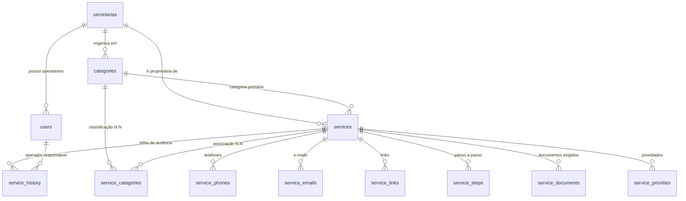
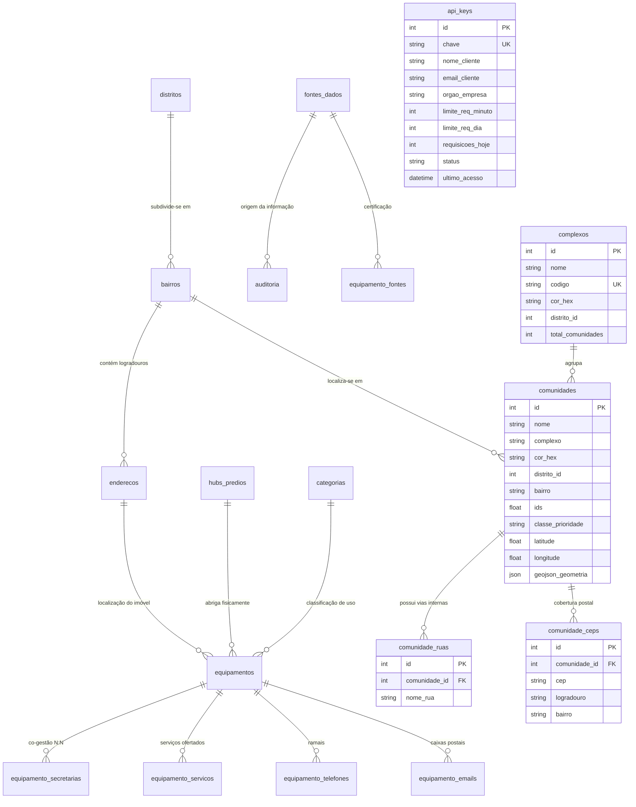

# 💾 Modelo de Dados e Especificação de Bancos
## Portal Unificado PMDC — Carta de Serviços ao Cidadão + SIGEM
**Prefeitura Municipal de Duque de Caxias — RJ**  
**Versão:** 2.2 (Atualizada com Módulo de Comunidades e Favelas do SIMAC, Complexos e Logradouros)  
**Data:** 20/10/2026  

---

## 1. Visão Geral dos Motores de Persistência

O Portal Unificado utiliza uma arquitetura híbrida de armazenamento com três frentes especializadas:

1. **🐬 MySQL (`carta_de_servico`):**
   - **Propósito:** Catálogo administrativo, secretarias, operadores setoriais, requisitos, contatos e histórico de auditoria dos serviços públicos ao cidadão.
   - **Charset / Collation:** `utf8mb4` / `utf8mb4_unicode_ci`.
   - **Engine:** InnoDB (suporte a transações ACID e Foreign Keys).
   - **Volumetria Real:** 372 serviços públicos cadastrados, 18 secretarias municipais e 19 categorias.
2. **📦 SQLite V2 (`dados/enderecos_duque_de_caxias_v2.db`):**
   - **Propósito:** Cadastro técnico territorial, divisão distrital, logradouros, equipamentos públicos, gestão de chaves de API (`api_keys`), geolocalização com coordenadas GPS e **cadastro integral das 105 comunidades e complexos de favelas**.
   - **Driver:** Nativo do Node 22 (`DatabaseSync` de `node:sqlite`).
   - **Volumetria Real:** 466 equipamentos públicos, 4 distritos municipais, 118 bairros oficiais, 428 endereços, 4 chaves de API, 542 eventos de auditoria, **105 comunidades / favelas cadastradas** (66 oficiais dos 10 Grandes Complexos + 39 setores periféricos), **11 complexos territoriais**, **2.199 ruas internas mapeadas** e **225 CEPs vinculados**.
3. **🗺️ Camada Geoespacial em Arquivo (`public/sigem/dados/geojson/` e `dados/`):**
   - **Propósito:** Geometrias vetoriais de alta precisão para plotagem no Leaflet, Point-in-Polygon e exportação cartográfica.
   - **Volumetria Real:**
     - 20 linhas de ônibus municipais (`rotas_onibus_tarifa_zero.geojson`).
     - 1.795 paradas de ônibus com coordenadas (`paradas_onibus_tarifa_zero.geojson`).
     - **105 polígonos de comunidades com cores e cortes por complexo** (`comunidades.geojson` e `dados/comunidades_master.json`).
     - Contorno oficial do município (`Duque_de_Caxias.geojson`).
     - 10 pastas de arquivos GeoJSON individuais de grandes complexos em `dados/geojson_comunidades/`.

---

## 2. Modelo MySQL — Carta de Serviços

### 2.1 Análise da Duplicidade: `services.category_id` vs `service_categories`
- **`services.category_id`:** Armazena o ID da **Categoria Primária / Principal** do serviço (utilizado para agrupamentos rápidos 1:1, filtros simples no frontend e compatibilidade retroativa com relatórios).
- **`service_categories`:** Tabela pivot que implementa a relação **N:N (Muitos para Muitos)**, permitindo que um serviço pertença simultaneamente a duas ou mais áreas temáticas.
- **Regra de Coexistência no Backend:** No [src/routes/cdsServices.ts](file:///c:/Users/501379.PMDC/Desktop/unificados/src/routes/cdsServices.ts), ao salvar um serviço, o primeiro elemento do array `category_ids[0]` é gravado automaticamente em `services.category_id`, enquanto a lista completa é persistida em `service_categories`.

---

## 3. Modelo SQLite — SIGEM (Território, Equipamentos e Credenciais)

### 3.1 Esclarecimento Factual sobre `auditoria.fonte_id` e `fontes_dados`
- A tabela **`fontes_dados`** existe no SQLite e possui 7 categorias de procedência (`API_TRANSPARENCIA`, `CNES_DATASUS`, `INEP_MEC`, `ORIENTAHUB_SQL`, `PLANILHA_INTERNA`, `LEVANTAMENTO_IN_LOCO`, `DIARIO_OFICIAL`).
- A tabela **`auditoria`** possui a coluna `fonte_id` com a constraint `FOREIGN KEY (fonte_id) REFERENCES fontes_dados(id)`.
- Dos 542 registros de auditoria existentes no banco, **520 estão devidamente associados a um `fonte_id` válido**.

### 3.2 Diagnóstico dos 118 Bairros Oficiais
- A tabela `bairros` do SQLite contém **118 registros**, cobrindo todas as denominações oficiais de bairros, vilas e setores cadastrais reconhecidos pela municipalidade distribuídos pelos 4 distritos administrativos.

### 3.3 Especificação da Tabela `api_keys` (Controle de Acesso v1)
A tabela `api_keys` implementa a emissão, validação de segurança e limitação de taxa por cliente parceiro:
- Chaves geradas com prefixo `pmdc_live_` e 40 caracteres hexadecimais (`crypto.randomBytes(20)`).
- Limites padrão: 60 ou 120 req/minuto e 10.000 a 50.000 req/dia.
- Contador `requisicoes_hoje` resetado automaticamente a cada virada de dia (`ultimo_reset_dia = date('now')`).

### 3.4 Especificação do Módulo de Favelas e Comunidades (Herança SIMAC)
Integrado ao banco SQLite para permitir cruzamento imediato entre dados sociais e equipamentos públicos:
- **102 Comunidades / Favelas:** Polígonos vetoriais, centroides georreferenciados, indicadores de vulnerabilidade IDS e priorização de atendimento.
- **11 Complexos e Agrupamentos:** Agrupamento por macro-regiões (Ex: Complexo da Mangueirinha, Complexo do Lixão, Complexo de Vila Operária, Complexo de Imbariê, etc.) com paleta de cores hexadecimais padronizada para mapas temáticos.
- **2.225 Vias Internas:** Cadastro de ruas, travessas e becos internos historicamente mapeados no projeto SIMAC.
- **236 Faixas de CEP:** Códigos postais e logradouros de referência cadastrados pela Empresa Brasileira de Correios e Telégrafos (ECT).

---

## 4. Dicionário de Tabelas do Sistema

### Tabelas MySQL (`carta_de_servico`)

| Tabela | Colunas Principais | Índices e Chaves | Regra de Exclusão (FK) |
| :--- | :--- | :--- | :--- |
| `secretarias` | `id`, `name`, `code` | PK (`id`), UNIQUE (`code`) | Restrita |
| `users` | `id`, `secretaria_id`, `username`, `password_hash`, `role` | PK (`id`), UNIQUE (`username`), FK (`secretaria_id`) | ON DELETE CASCADE |
| `categories` | `id`, `secretaria_id`, `name` | PK (`id`), FK (`secretaria_id`) | ON DELETE CASCADE |
| `services` | `id`, `secretaria_id`, `category_id`, `name`, `status`, `waiting_time`, `max_deadline`, `cost` | PK (`id`), FULLTEXT (`name`, `description`), FKs | ON DELETE CASCADE |
| `service_phones` | `id`, `service_id`, `phone` | PK (`id`), FK (`service_id`) | ON DELETE CASCADE |
| `service_emails` | `id`, `service_id`, `email` | PK (`id`), FK (`service_id`) | ON DELETE CASCADE |
| `service_links` | `id`, `service_id`, `link` | PK (`id`), FK (`service_id`) | ON DELETE CASCADE |
| `service_steps` | `id`, `service_id`, `step_number`, `description` | PK (`id`), FK (`service_id`) | ON DELETE CASCADE |
| `service_documents` | `id`, `service_id`, `document_name` | PK (`id`), FK (`service_id`) | ON DELETE CASCADE |
| `service_priorities` | `id`, `service_id`, `priority_name` | PK (`id`), FK (`service_id`) | ON DELETE CASCADE |
| `service_categories` | `service_id`, `category_id` | PK composta (`service_id`, `category_id`), FKs | ON DELETE CASCADE |
| `service_history` | `id`, `service_id`, `user_id`, `action`, `field_name`, `old_value`, `new_value`, `ip_address`, `created_at` | PK (`id`), FK (`service_id`), FK (`user_id`) | ON DELETE CASCADE *(proposto soft delete para blindagem)* |

### Tabelas SQLite (`dados/enderecos_duque_de_caxias_v2.db`)

| Tabela | Colunas Principais | Índices e Chaves |
| :--- | :--- | :--- |
| `distritos` | `numero`, `nome`, `sede` | PK (`numero`) |
| `bairros` | `id`, `nome`, `distrito_id`, `distrito_numero`, `zona` | PK (`id`), FK (`distrito_id`) |
| `enderecos` | `id`, `bairro_id`, `logradouro`, `numero`, `cep`, `latitude`, `longitude` | PK (`id`), FK (`bairro_id`) |
| `equipamentos` | `id`, `nome`, `categoria_id`, `endereco_id`, `hub_id`, `codigo_cnes`, `codigo_inep`, `status` | PK (`id`), FKs |
| `hubs_predios` | `id`, `codigo_hub`, `nome`, `endereco_id`, `regime_imovel` | PK (`id`), FK (`endereco_id`) |
| `categorias` | `id`, `nome`, `macrosetor`, `icone`, `cor_hex` | PK (`id`) |
| `fontes_dados` | `id`, `nome`, `tipo`, `url_origem`, `confiabilidade` | PK (`id`) |
| `auditoria` | `id`, `tabela_afetada`, `registro_id`, `operacao`, `dados_anteriores`, `dados_novos`, `usuario`, `fonte_id` | PK (`id`), FK (`fonte_id`) |
| `api_keys` | `id`, `chave`, `nome_cliente`, `email_cliente`, `orgao_empresa`, `limite_req_minuto`, `limite_req_dia`, `requisicoes_hoje`, `ultimo_reset_dia`, `total_requisicoes`, `status`, `ultimo_acesso`, `criado_em`, `notas` | PK (`id`), UNIQUE (`chave`) |
| `complexos` | `id`, `nome`, `codigo`, `cor_hex`, `distrito_id`, `total_comunidades`, `criado_em` | PK (`id`), UNIQUE (`codigo`) |
| `comunidades` | `id`, `nome`, `complexo`, `cor_hex`, `distrito_id`, `bairro`, `ids`, `classe_prioridade`, `latitude`, `longitude`, `geojson_geometria`, `criado_em` | PK (`id`), INDEX (`complexo`, `distrito_id`, `nome`) |
| `comunidade_ruas` | `id`, `comunidade_id`, `nome_rua`, `criado_em` | PK (`id`), FK (`comunidade_id`), INDEX (`comunidade_id`, `nome_rua`) |
| `comunidade_ceps` | `id`, `comunidade_id`, `cep`, `logradouro`, `bairro`, `localidade`, `uf`, `ibge`, `ddd`, `criado_em` | PK (`id`), FK (`comunidade_id`), INDEX (`comunidade_id`, `cep`) |
| `vw_equipamentos_consolidada` | View unificada com joins de equipamentos, endereços, bairros, distritos, categorias e secretarias | VIEW |
